# Cloud-Native Task Manager
### End-to-End DevOps | AWS · Terraform · Jenkins · Docker · Kubernetes · Prometheus · Grafana

A hands-on DevOps portfolio project demonstrating the delivery and operation of a Flask + PostgreSQL application through automated CI/CD, containerization, Kubernetes orchestration, AWS infrastructure management, security hardening, and observability.

<p align="center">
  
  
  
  
  
  
  
  
  
</p>

<p align="center">
  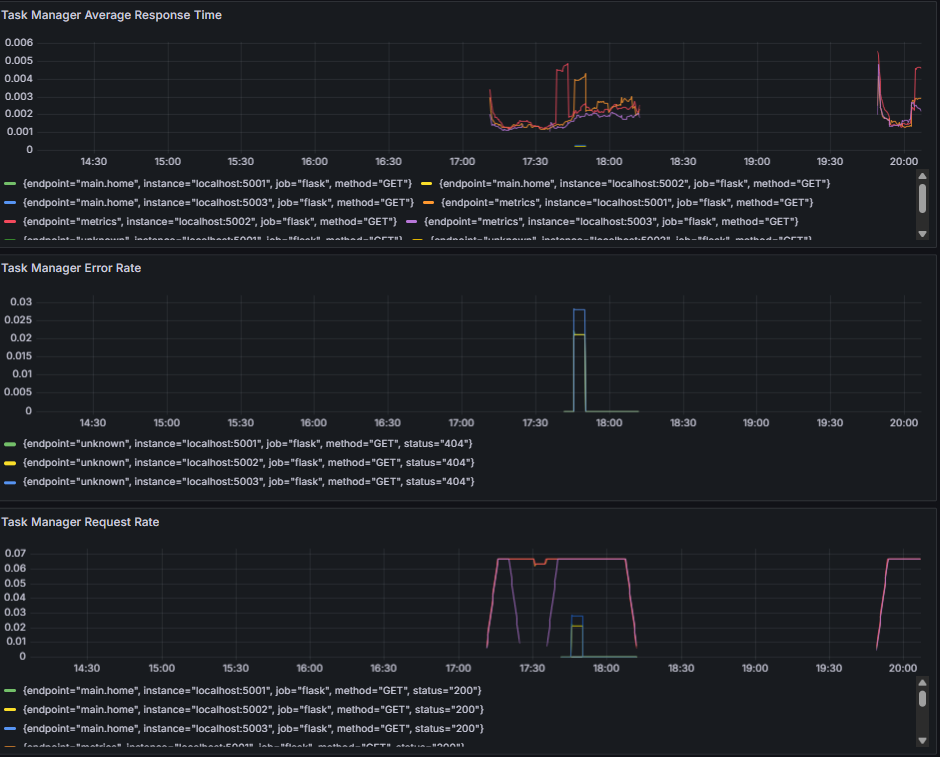
</p>

> **Project repository:** [github.com/shamiltech8/cloud-native-task-manager](https://github.com/shamiltech8/cloud-native-task-manager)

---

## Project at a glance

| Area | Implementation |
|---|---|
| Application | Flask, Gunicorn, SQLAlchemy |
| Database | PostgreSQL |
| CI/CD | GitHub → Jenkins → pytest → Docker → Amazon ECR → Kubernetes |
| Infrastructure as Code | Terraform, AWS EC2, Security Group, ECR, S3 remote state |
| Configuration management | Ansible lab practice (maintained separately; not currently a Jenkins pipeline stage) |
| Container platform | Docker, Docker Compose, Kubernetes / Minikube |
| Observability | Prometheus, Grafana, Node Exporter, cAdvisor, kube-state-metrics |
| Security | Non-root container, read-only filesystem, dropped capabilities, Kubernetes Secrets, NetworkPolicy |
| Latest recorded validation | 4 pytest tests passed; Flask deployment 3/3 replicas available |

## Highlights

- **Automated application delivery:** GitHub changes trigger the Jenkins workflow for testing, Docker image creation, ECR publishing, and Kubernetes deployment.
- **Traceable container releases:** images are tagged with the Jenkins build number and Git commit, for example `build-34-d2256bd`.
- **Hardened application container:** runs as UID `10001`, with privilege escalation disabled, Linux capabilities dropped, and a read-only root filesystem.
- **Infrastructure as Code:** existing AWS resources were imported into Terraform state; an encrypted S3 remote backend and state locking were configured.
- **Controlled infrastructure changes:** the Terraform pipeline runs validation and planning before a manual approval gate for `terraform apply`.
- **Monitoring and dashboards:** application, host, container, and Kubernetes metrics are collected by Prometheus and visualized in Grafana.
- **Practical troubleshooting:** resolved ECR image-pull authentication, Jenkins pipeline structure, Kubernetes/local database connectivity, and Prometheus scrape issues.
- **Isolated test data:** the latest local test run used `task_manager_test`, separate from the application's `task_manager` database.

---

## Architecture

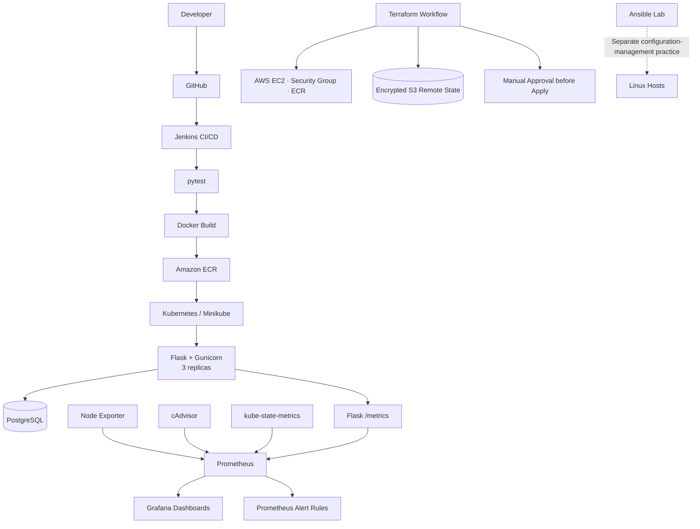

**Workflow note:** The application CI/CD pipeline and Terraform infrastructure pipeline are related but distinct workflows. Ansible is documented as separate lab practice and is not represented as an automated stage in the application's Jenkins pipeline.

## Technology stack

| Layer | Tools |
|---|---|
| Application | Python 3.12, Flask, Gunicorn, SQLAlchemy |
| Database | PostgreSQL |
| Containers | Docker, Docker Compose |
| Reverse proxy / load balancing | Nginx |
| Orchestration | Kubernetes, Minikube |
| CI/CD | Jenkins, GitHub |
| Cloud / registry | AWS EC2, Amazon ECR, Amazon S3 |
| Infrastructure as Code | Terraform |
| Configuration management | Ansible |
| Metrics collection | Prometheus, Node Exporter, cAdvisor, kube-state-metrics |
| Visualization | Grafana |
| Testing | pytest |
| Operating environment | Linux / Ubuntu |

---

## 1. Application and database

The application is built with Flask and uses PostgreSQL through SQLAlchemy.

Implemented application components include:

- Flask application factory and route registration.
- User and task data models and their relationships.
- PostgreSQL connectivity and database configuration.
- Environment-based configuration for secrets and database settings.
- Gunicorn as the WSGI application server.
- Application instrumentation exposed through `/metrics`.

The local configuration loads the project `.env` file without overriding environment variables already supplied by the execution environment. This allows environment-specific settings to take precedence.

## 2. Docker and containerization

Docker packages the Flask application and its runtime dependencies.

Implementation includes:

- A Python 3.12 slim-based application image.
- Gunicorn serving the application on port `5000`.
- Docker Compose for multi-container development and testing.
- PostgreSQL service integration.
- Nginx reverse-proxy / load-balancing configuration.
- Container image tagging and publishing to Amazon ECR.

### Container hardening

The application container is configured with:

- Dedicated non-root user: `UID 10001`.
- `allowPrivilegeEscalation: false`.
- Linux capabilities dropped.
- Read-only root filesystem.
- Runtime secrets supplied through environment configuration and Kubernetes Secrets.

## 3. Kubernetes deployment

The application is deployed to a local Kubernetes cluster using Minikube.

### Kubernetes resources

| Resource | Purpose |
|---|---|
| Flask Deployment | Runs three application replicas |
| Flask Service | Exposes the application through NodePort `31922` |
| PostgreSQL Deployment and Service | Runs and exposes the database inside the cluster |
| PersistentVolumeClaim | Provides persistent storage for PostgreSQL |
| ConfigMap | Supplies non-sensitive application configuration |
| Kubernetes Secrets | Supplies sensitive configuration |
| ServiceAccount | Provides an application service identity |
| NetworkPolicy | Restricts access to the PostgreSQL workload |
| Image pull secret | Authenticates Kubernetes image pulls from ECR |

### Deployment validation

The latest recorded deployment check showed:

```text
deployment "flask" successfully rolled out

NAME    READY   UP-TO-DATE   AVAILABLE
flask   3/3     3            3
```

The deployed image recorded during that validation was:

```text
148908330969.dkr.ecr.ap-south-1.amazonaws.com/cloud-native-task-manager:build-34-d2256bd
```

This is a recorded validation image tag, not a promise that future deployments will use the same tag.

<p align="center">
  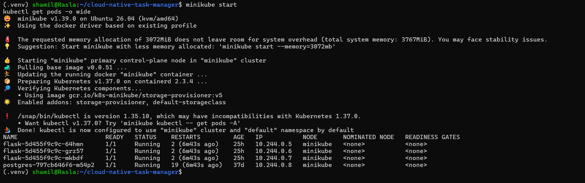
</p>

## 4. Jenkins CI/CD and Amazon ECR

The application delivery workflow connects GitHub, Jenkins, Docker, Amazon ECR, and Kubernetes.

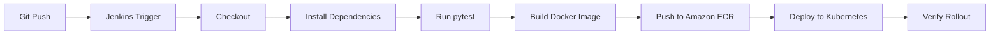

### Pipeline stages

1. **Checkout:** retrieve the source code from GitHub.
2. **Project checks and dependencies:** prepare the build environment.
3. **Test:** execute the automated test suite.
4. **Build:** create the Docker image.
5. **Publish:** authenticate to ECR and push the versioned image.
6. **Deploy:** update the Kubernetes workload.
7. **Verify:** check the deployment rollout.

Image tags include the build number and commit identifier, making it possible to trace a deployed image back to its source revision.

<p align="center">
  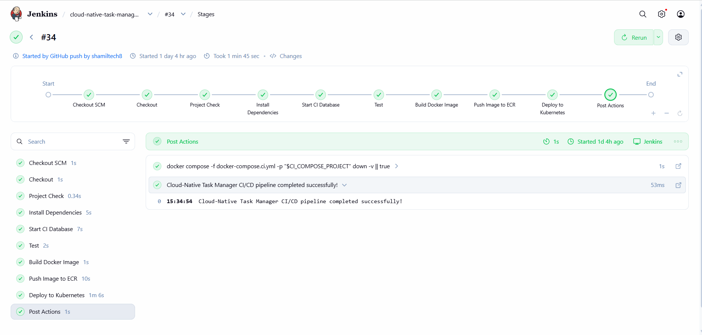
</p>

### AWS ECR authentication

Kubernetes uses an image-pull secret to authenticate to Amazon ECR. Because ECR authorization tokens expire, the deployment workflow includes a refresh step for the Kubernetes `ecr-secret`.

## 5. Terraform — Infrastructure as Code

Terraform was used to manage the AWS infrastructure associated with the project.

### AWS resources and state

The Terraform work covers:

- Existing EC2 instance and security group imported into Terraform state.
- Amazon ECR repository management.
- AWS provider configuration, variables, and outputs.
- Encrypted S3 remote state.
- S3 state locking using the configured lock-file mechanism.
- Terraform validation, planning, and drift review.

An earlier Terraform plan was reviewed with zero drift at that point in the project. This is a historical validation result, not a guarantee that the infrastructure has no drift now.

### Terraform CI/CD workflow

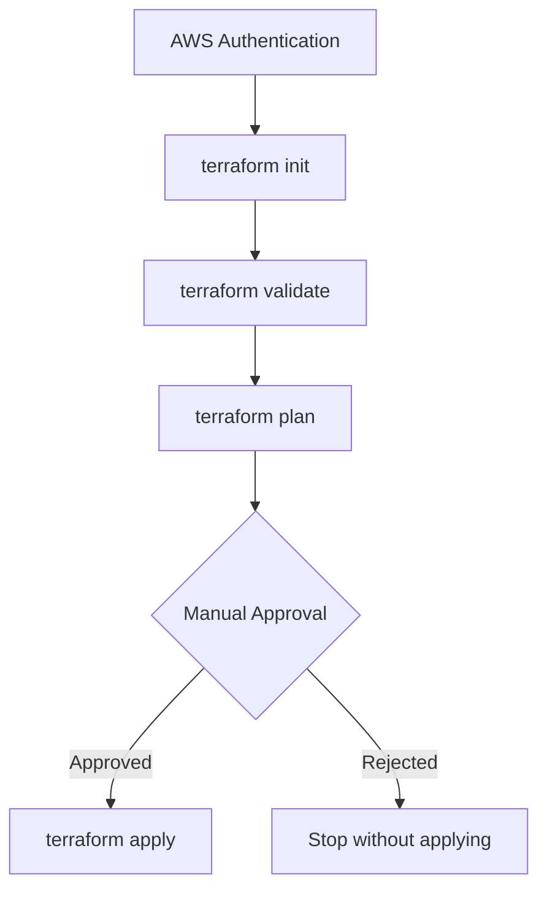

The manual approval gate ensures that planned infrastructure changes are reviewed before they are applied.

> Keep the Terraform source repository linked here when confirming its final public URL. Do not confuse the Terraform project repository with this application repository.

## 6. Ansible — Configuration management

Ansible was studied and practiced in a separate Linux automation lab as part of the wider DevOps learning work.

Topics include:

- Inventory and managed-host configuration.
- SSH-based host connectivity.
- Ad hoc commands.
- YAML playbooks.
- Repeatable Linux configuration tasks.
- Configuration-management and deployment automation concepts.

**Scope:** Ansible is not currently claimed as an integrated stage of this application's Jenkins pipeline. The Ansible lab can be linked separately when its repository is published.

## 7. Prometheus and Grafana — Observability

The monitoring stack collects application and infrastructure metrics and presents them through Grafana dashboards.

### Monitoring architecture

| Scrape target | Metrics |
|---|---|
| Flask application | Application request metrics and custom instrumentation |
| Node Exporter | Host CPU, memory, disk, and network |
| cAdvisor | Container resource usage |
| kube-state-metrics | Kubernetes workload and pod state |
| Prometheus | Prometheus self-monitoring |

The Flask application exposes a Prometheus-compatible `/metrics` endpoint. One application metric observed during validation was:

```text
task_manager_http_requests_total
```

### Prometheus targets

<p align="center">
  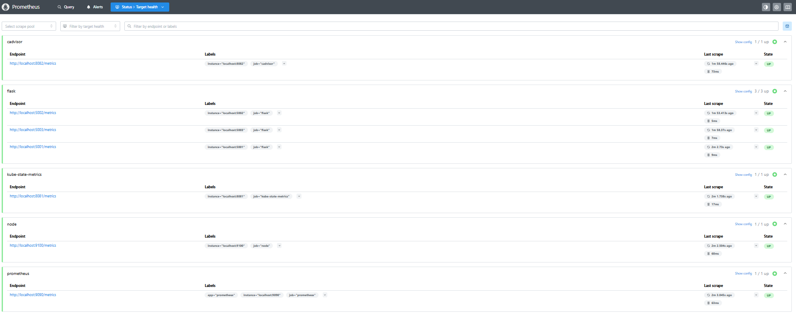
</p>

### Grafana dashboards

The monitoring work includes four exported Grafana dashboards covering the application, containers, Linux infrastructure, and Kubernetes.

#### Application overview

<p align="center">
  
</p>

#### Container monitoring

<p align="center">
  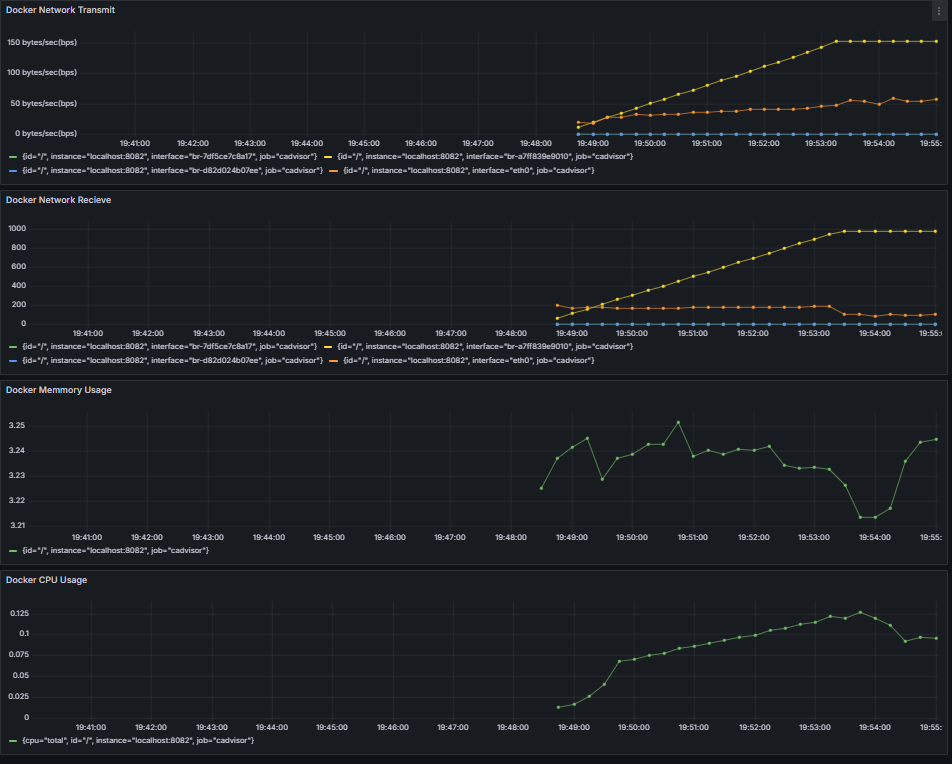
</p>

#### Linux infrastructure monitoring

<p align="center">
  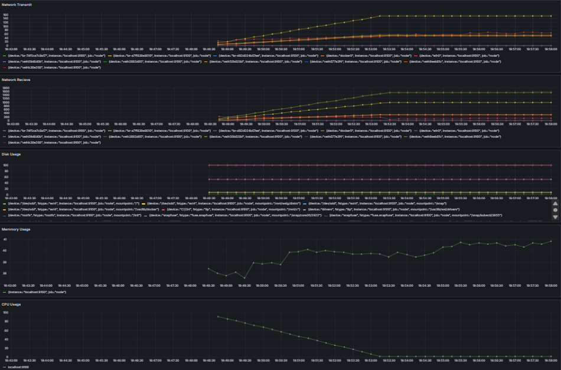
</p>

#### Kubernetes monitoring

<p align="center">
  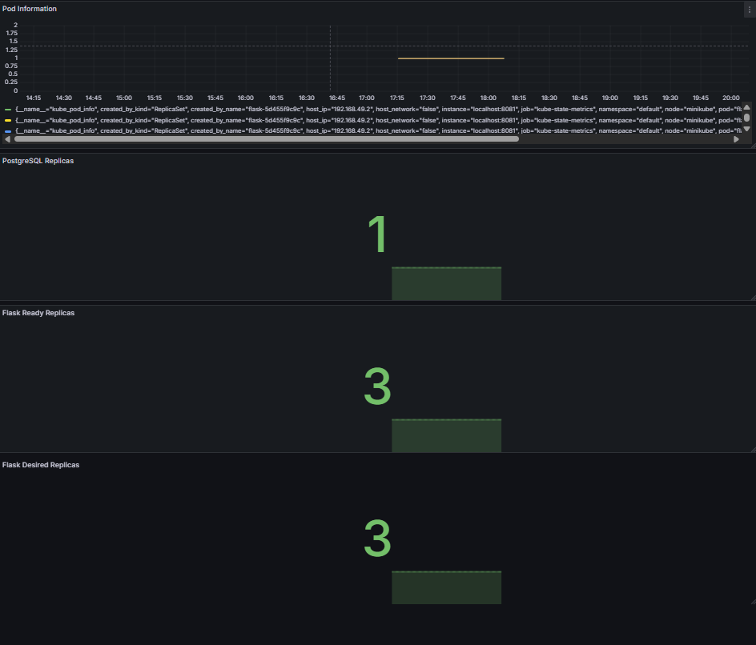
</p>

### Prometheus alert rules

The monitoring configuration includes rules for host availability, application availability, Kubernetes replica health, and resource utilization.

| Alert | Condition |
|---|---|
| `NodeExporterDown` | Node Exporter target is down |
| `FlaskInstanceDown` | A Flask application target is down |
| `FlaskReplicaMismatch` | Available Flask replicas do not match the desired replica count |
| `HighCPUUsage` | CPU usage exceeds the configured threshold |
| `HighMemoryUsage` | Memory usage exceeds the configured threshold |
| `LowDiskSpace` | Available disk space falls below the configured threshold |

`FlaskInstanceDown` was verified by stopping a Flask container and observing the alert transition to firing in Prometheus.

<p align="center">
  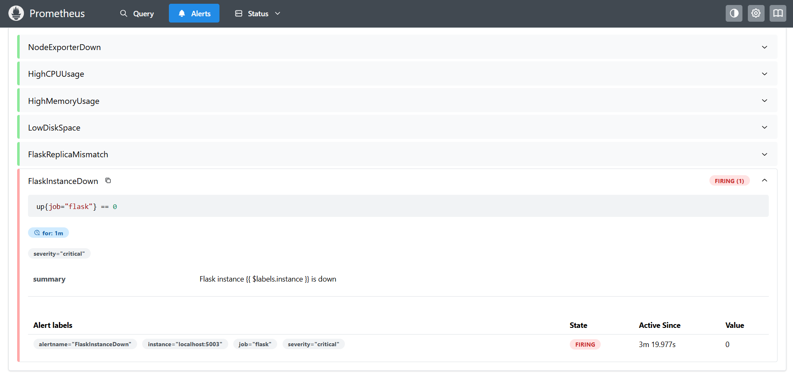
</p>

**Alerting scope:** Prometheus rule firing was verified. Alertmanager notification delivery (for example, email or Slack) is not claimed as configured.

## 8. Security practices

| Layer | Security measure |
|---|---|
| Application configuration | Environment variables and local `.env` excluded from Git |
| Kubernetes | Sensitive configuration stored in Kubernetes Secrets |
| Container | Non-root user, read-only filesystem, no privilege escalation |
| Linux capabilities | All unnecessary capabilities dropped |
| Network | NetworkPolicy restricts access to PostgreSQL |
| Registry | Authenticated ECR image pulls |
| Infrastructure | Terraform plan review and manual approval before apply |

These controls demonstrate security-conscious implementation. They do not represent a complete security audit or guarantee that every dependency and infrastructure component is vulnerability-free.

## 9. Automated testing and validation

The pytest suite covers database connectivity, user creation, and user-task relationship behavior.

### Latest recorded test result

```text
....                                                                     [100%]
4 passed in 1.28s
```

Tests were executed against a separate `task_manager_test` database rather than the main `task_manager` database.

| Validation | Recorded result |
|---|---|
| pytest suite | **4 passed** |
| Test duration | 1.28 seconds |
| PostgreSQL connection | Successful |
| Test database isolation | `task_manager_test` |
| Kubernetes rollout | Successful |
| Flask replicas | 3/3 available |
| Gunicorn startup | Successful |
| Prometheus `/metrics` | HTTP 200 previously verified |

Results reflect the latest recorded validation session. Re-run checks after code or infrastructure changes.

## 10. Major challenges and troubleshooting

The project involved practical troubleshooting across cloud authentication, CI/CD syntax, networking, and observability.

### Challenge 1 — Kubernetes `ImagePullBackOff` caused by expired ECR credentials

**Problem:** Kubernetes could not pull the application image from Amazon ECR because the authorization token stored in the Kubernetes image-pull secret had expired.

**Root cause:** ECR authorization tokens are temporary. The Kubernetes secret was not being refreshed before subsequent image pulls.

**Resolution:**
- Inspected pod events and image-pull errors with `kubectl describe pod`.
- Checked AWS identity and ECR authentication.
- Added a refresh process for the Kubernetes `ecr-secret` to the deployment workflow.
- Re-ran the deployment and checked pod readiness.

**Outcome:** Kubernetes successfully authenticated to ECR and the three Flask replicas became available.

**Tools:** AWS CLI, Amazon ECR, Docker, Kubernetes, Jenkins.

### Challenge 2 — Jenkins Declarative Pipeline rejected a misplaced stage

**Problem:** Jenkins reported `Undefined section "stage"` while parsing the pipeline.

**Root cause:** The Docker image build stage was placed outside the required `stages` block in the Declarative Pipeline.

**Resolution:**
- Read the Jenkins console output.
- Located the incorrectly nested stage.
- Moved the Docker build stage inside the `stages` block.
- Re-ran the pipeline to verify the corrected structure.

**Outcome:** Jenkins accepted the pipeline structure and the Docker build stage executed.

**Tools:** Jenkins, Groovy, Jenkinsfile, Docker.

### Challenge 3 — Local tests could not resolve the Kubernetes PostgreSQL service

**Problem:** Local pytest execution failed with:

```text
could not translate host name "postgres" to address:
Name or service not known
```

**Root cause:** `postgres` is a Kubernetes Service DNS name. It resolves inside the cluster network, not automatically from a test process running on the Ubuntu host.

**Resolution:**
- Checked the PostgreSQL pod and Service endpoints.
- Forwarded the database Service to the local host with `kubectl port-forward`.
- Verified PostgreSQL connectivity through SQLAlchemy.
- Created a dedicated `task_manager_test` database.
- Set `DATABASE_HOST`, `DATABASE_PORT`, and `DATABASE_NAME` for the local test process.

**Outcome:** The local tests connected to the isolated database and the complete suite passed: **4 passed in 1.28 seconds**.

**Tools:** Kubernetes, kubectl, PostgreSQL, Python, SQLAlchemy, pytest.

### Additional monitoring troubleshooting

Prometheus could not reliably scrape individual Flask container metrics through a load-balanced endpoint. The monitoring setup was adjusted to expose and scrape each Flask container directly through its own localhost-only port, avoiding random load-balancer routing between application instances.

**Troubleshooting method:** reproduce the issue → inspect logs and events → identify the root cause → make a controlled change → verify the result.

## 11. Design decisions

| Decision | Reason |
|---|---|
| Gunicorn for Flask | Use a production-oriented WSGI server instead of Flask's development server |
| Nginx reverse proxy / load balancer | Provide a single application entry point and distribute requests |
| Three Flask replicas in Kubernetes | Practice replicated workloads and rollout behavior |
| Dedicated test database | Prevent tests from modifying application data |
| Direct metrics scraping per Flask container | Avoid inconsistent counter collection through load-balanced routing |
| Minikube for Kubernetes practice | Practice Kubernetes resources locally without requiring a managed cluster |
| Terraform remote state and locking | Support shared, consistent infrastructure state |
| Manual approval before Terraform apply | Review infrastructure changes before applying them |

## 12. Run locally

### Prerequisites

- Git
- Docker Engine
- Docker Compose
- Python 3.12-compatible environment

### Start with Docker Compose

```bash
git clone https://github.com/shamiltech8/cloud-native-task-manager.git
cd cloud-native-task-manager

cp .env.example .env
# Edit .env and provide SECRET_KEY, DB_USER, and DB_PASSWORD.

docker compose up --build
```

Open the application at `http://localhost` when the Compose services are running.

> Confirm the current `.env.example` and Compose port mappings before running. Never commit `.env` or real credentials.

### Run tests safely

The test suite writes to the database. Configure a dedicated test database before running it.

```bash
source .venv/bin/activate

export DATABASE_HOST=127.0.0.1
export DATABASE_PORT=5433
export DATABASE_NAME=task_manager_test

python -m pytest -q
```

The command assumes the PostgreSQL test database is reachable on local port `5433` (for example, through the documented Kubernetes port-forward). Do not run database-mutating tests against a database containing important application data.

## 13. Repository structure

```text
cloud-native-task-manager/
├── app/                    # Flask application, routes, models, metrics
├── k8s/                    # Kubernetes manifests
├── monitoring/             # Prometheus configuration, rules, Grafana dashboards
├── nginx/                  # Nginx configuration
├── devops-toolkit/         # Build, deploy, health-check and helper scripts
├── scripts/                # Deployment and secret helper scripts
├── docs/
│   ├── images/              # README screenshots
│   └── troubleshooting.md  # Optional detailed troubleshooting notes
├── Dockerfile
├── docker-compose.yml
├── docker-compose.ci.yml
├── Jenkinsfile
├── .env.example
├── config.py
├── run.py
├── requirements.txt
├── LICENSE
└── README.md
```

## 14. Scope and limitations

- The Kubernetes deployment validated in this project runs on **Minikube**, not Amazon EKS.
- AWS EC2, ECR, and Terraform work form the associated cloud infrastructure workflow.
- The Ansible lab is separate and is not currently an automated stage in the application Jenkins pipeline.
- Prometheus alert firing was verified; Alertmanager notification delivery is not claimed.
- This is a learning and portfolio project, not a production-audited service.

## 15. Future improvements

- [ ] Integrate Ansible playbooks into a verified automation workflow.
- [ ] Add Trivy image and dependency scanning to Jenkins.
- [ ] Configure Alertmanager notification delivery.
- [ ] Add reproducible AWS deployment documentation.
- [ ] Expand recovery and failure-injection testing.
- [ ] Add automated test fixtures and cleanup.
- [ ] Publish linked Terraform and Ansible repositories.
- [ ] Keep screenshots and exported Grafana dashboards synchronized with the current implementation.

## Author

**Mohammed Shamil KT**
GitHub: [@shamiltech8](https://github.com/shamiltech8)

---

If this project is useful, feel free to explore the repository and its implementation.
