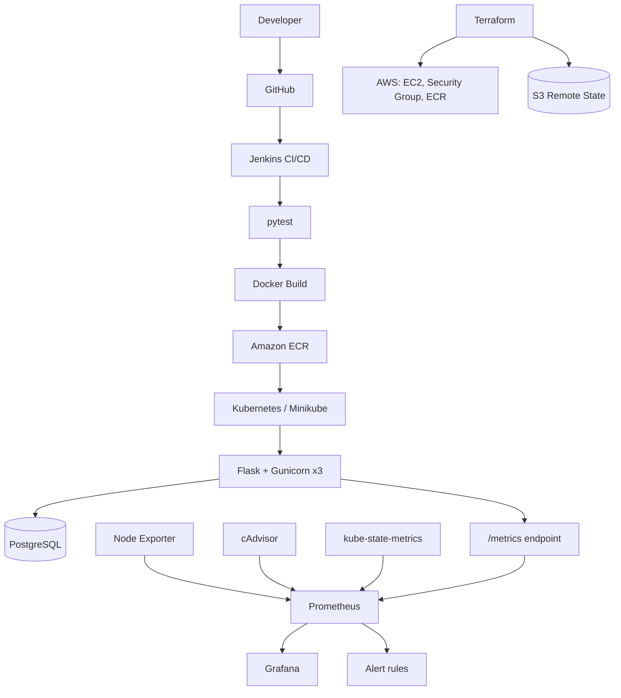

# Cloud-Native Task Manager

A Flask + PostgreSQL application delivered through a complete DevOps pipeline:
**Git push → Jenkins → pytest → Docker → Amazon ECR → Kubernetes**, with Terraform-managed AWS infrastructure and Prometheus/Grafana observability.


---

## Highlights

- **Automated CI/CD:** every push to GitHub triggers tests, a Docker image build, a push to Amazon ECR, and a Kubernetes deployment with rollout verification.
- **Hardened containers:** non-root user (UID 10001), read-only root filesystem, privilege escalation disabled, all Linux capabilities dropped, secrets delivered through Kubernetes Secrets.
- **Infrastructure as Code:** existing EC2 instance, security group, and ECR repository imported into Terraform, with encrypted S3 remote state, state locking, and a verified zero-drift plan.
- **Safe infrastructure changes:** the Terraform pipeline runs validate and plan, then requires **manual approval** before `apply`.
- **Observability:** custom `/metrics` endpoint plus Node Exporter, cAdvisor, and kube-state-metrics feeding Prometheus and four Grafana dashboards.
- **Alerting:** 6 Prometheus alert rules covering host health, resources, Flask availability, and Kubernetes replica mismatch. The Flask-down alert is verified to fire.
- **Tested:** 3 pytest tests running against an isolated test database.

## Architecture



## Tech Stack

| Area | Technologies |
|---|---|
| Application | Python 3.12, Flask, Gunicorn, SQLAlchemy |
| Database | PostgreSQL 16 |
| Containers | Docker, Docker Compose, Nginx (load balancer) |
| Orchestration | Kubernetes (Minikube) |
| CI/CD | Jenkins, GitHub |
| Cloud | AWS (EC2, ECR, S3) |
| Infrastructure as Code | Terraform |
| Monitoring | Prometheus, Grafana, Node Exporter, cAdvisor, kube-state-metrics |
| Testing | pytest |

## Quick Start (Docker Compose)

**Prerequisites:** Docker, Docker Compose, Git.

```bash
git clone https://github.com/shamiltech8/cloud-native-task-manager.git
cd cloud-native-task-manager

cp .env.example .env     # then set SECRET_KEY, DB_USER, DB_PASSWORD
docker compose up --build
```

Open **http://localhost**. Nginx on port 80 load-balances across three Flask containers (`flask1`, `flask2`, `flask3`), each also published on `127.0.0.1:5001` to `5003` for metrics scraping.

### Run the tests

Tests run against a separate `task_manager_test` database so your application data is never touched.

```bash
# one-time: create the test database
docker compose exec postgres sh -c 'psql -U "$POSTGRES_USER" -d "$POSTGRES_DB" -c "CREATE DATABASE task_manager_test;"'

python3 -m venv .venv && source .venv/bin/activate
pip install -r requirements.txt

set -a; source .env; set +a
export DATABASE_HOST=localhost DATABASE_NAME=task_manager_test
python -m pytest -q
```

## Kubernetes Deployment

The manifests in [`k8s/`](k8s/) deploy the app and its database to a local Minikube cluster.

| Resource | Details |
|---|---|
| Flask Deployment | 3 replicas, image pulled from Amazon ECR using an image-pull secret |
| Flask Service | NodePort `31922` |
| PostgreSQL | Deployment, Service, PersistentVolumeClaim, Secret |
| Network policy | Restricts access to the PostgreSQL pod |
| Config | ConfigMap and dedicated ServiceAccount |

```bash
minikube start
./scripts/create-k8s-secret.sh     # creates secrets locally, never committed
kubectl apply -f k8s/
kubectl rollout status deployment/flask
kubectl get pods -o wide
# open http://$(minikube ip):31922
```


## CI/CD Pipeline

Defined in the [`Jenkinsfile`](Jenkinsfile).

```text
Checkout → Project Check → Install Dependencies → Start CI Database → Test → Build Docker Image → Push Image to ECR → Deploy to Kubernetes
```

The deploy stage verifies the rollout with `kubectl rollout status`. Images are tagged with the build number and commit hash (for example `build-34-d2256bd`), so every deployment is traceable to a commit. Images are stored in Amazon ECR (`ap-south-1`).


## Infrastructure as Code (Terraform)

Terraform manages the AWS resources behind the project:

- EC2 instance and security group (imported into state, not recreated)
- ECR repository
- Remote state in S3 with encryption and lock-file support

A separate Jenkins pipeline handles infrastructure changes:

```text
AWS auth → init → validate → plan → manual approval → apply
```

Terraform source: [shamiltech8/terraform-task-manager](https://github.com/shamiltech8/terraform-task-manager)

## Monitoring and Alerting

Configuration lives in [`monitoring/`](monitoring/).

| Scrape job | Provides |
|---|---|
| `flask` (3 targets) | Application metrics such as `task_manager_http_requests_total` |
| `node` | Host CPU, memory, disk, network |
| `cadvisor` | Per-container resource usage |
| `kube-state-metrics` | Kubernetes deployment and pod state |
| `prometheus` | Prometheus self-monitoring |


### Grafana dashboards

Four dashboards are exported as JSON in `monitoring/`: application, containers, Linux infrastructure, and Kubernetes.

| Containers | Linux infrastructure |
|---|---|
|  |  |


### Alert rules

| Alert | Condition |
|---|---|
| `NodeExporterDown` | Node Exporter target down for 1 minute |
| `FlaskInstanceDown` | Any Flask instance down for 1 minute |
| `FlaskReplicaMismatch` | Kubernetes Flask replicas not all ready for 2 minutes |
| `HighCPUUsage` | CPU above 80% for 5 minutes |
| `HighMemoryUsage` | Memory above 80% for 5 minutes |
| `LowDiskSpace` | Free disk below 20% for 5 minutes |

`FlaskInstanceDown` was verified by stopping a Flask container and watching the alert move from pending to firing.


## Security

| Layer | Control |
|---|---|
| Container | Non-root user, read-only filesystem, no privilege escalation, capabilities dropped |
| Secrets | Kubernetes Secrets; `.env` and secret manifests excluded from Git |
| Network | NetworkPolicy limiting access to PostgreSQL |
| Registry | Authenticated ECR image pulls |
| Infrastructure | Terraform plan review and manual approval before apply |

## Design Decisions

- **Gunicorn behind Nginx:** production-grade WSGI serving, with Nginx load-balancing three replicas.
- **Separate test database:** tests create and delete data, so they must never run against the main database.
- **Scrape each Flask container directly:** scraping through the load balancer would hit a random instance each time and make counters inconsistent.
- **Minikube instead of EKS:** zero cost while practicing the same Kubernetes primitives; the manifests are portable to a managed cluster.
- **Manual approval before `terraform apply`:** infrastructure changes are reviewed from the plan before anything is modified.
- **Remote state with locking:** prevents state corruption and conflicting applies.

## Challenges and Lessons

Full write-ups are in [`docs/troubleshooting.md`](docs/troubleshooting.md).

| Problem | Root cause | Fix |
|---|---|---|
| Pods stuck in `ImagePullBackOff` | ECR authorization tokens are temporary, and the Kubernetes image-pull secret had expired | Added an automated refresh of `ecr-secret` to the deployment workflow; all 3 replicas became available |
| Jenkins error `Undefined section "stage"` | The Docker build stage sat outside the `stages` block of the declarative pipeline | Moved it inside `stages`; the pipeline was accepted and ran |
| Local tests: `could not translate host name "postgres"` | The `postgres` service name only resolves inside the cluster or Docker network, not from the host | Used a dedicated `task_manager_test` database and overrode the host and database name for the test run |
| Prometheus Flask target down | Containers were only reachable inside the Docker network behind Nginx | Published each container on its own localhost-only port and scraped them directly |
| Alerts that could not fire | No rule watched the Docker Flask containers | Added `FlaskInstanceDown` and verified it by stopping a container |

**Approach:** identify the failure, read logs and events, find the root cause, apply a controlled fix, verify the result.

## Repository Structure

```text
.
├── app/                    # Flask application (routes, models, auth, forms, metrics)
│   ├── templates/
│   └── static/
├── k8s/                    # Kubernetes manifests
├── monitoring/             # Prometheus config, alert rules, Grafana dashboards
├── nginx/                  # Nginx load-balancer configuration
├── devops-toolkit/         # Build, deploy, rollback, health-check scripts
├── scripts/                # Helper scripts (secret creation, deployment)
├── docs/                   # Screenshots, troubleshooting log, learning notes
├── Dockerfile
├── docker-compose.yml
├── docker-compose.ci.yml
├── Jenkinsfile
├── .env.example
├── config.py
├── run.py
├── requirements.txt
├── LICENSE
└── test_*.py               # pytest suite
```

## Scope and Limitations

- Kubernetes runs on **Minikube**; this is not a managed production cluster on AWS.
- Alert rules are verified to fire in Prometheus. Notification delivery through Alertmanager is not configured.
- Built as a learning and portfolio project, not a production-audited system.

## Roadmap

- [ ] Add Trivy image and dependency scanning to the Jenkins pipeline
- [ ] Add Alertmanager with Slack or email notifications
- [ ] Integrate Ansible playbooks into the delivery workflow (currently practiced separately in a lab)
- [ ] Move tests into a `tests/` directory with fixtures for automatic cleanup
- [ ] Publish reproducible AWS deployment steps

## License

Released under the [MIT License](LICENSE).

## Author

**Mohammed Shamil KT**
GitHub: [@shamiltech8](https://github.com/shamiltech8)
